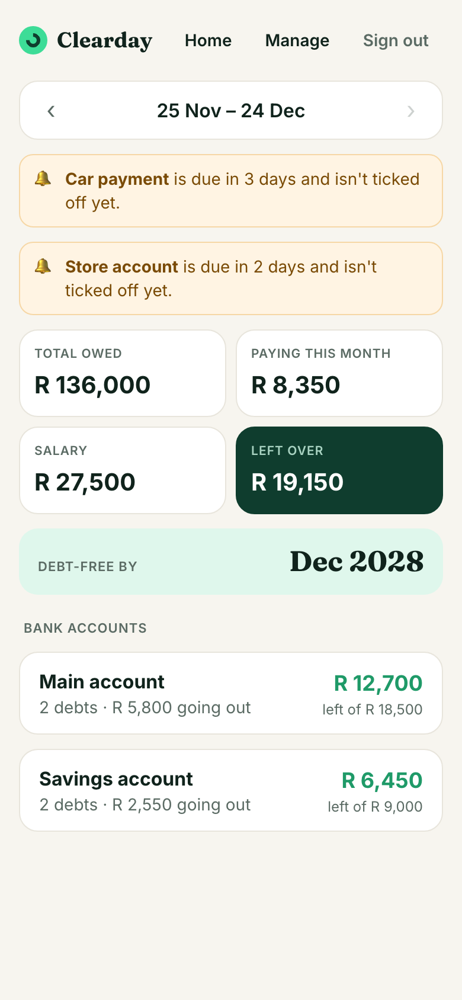
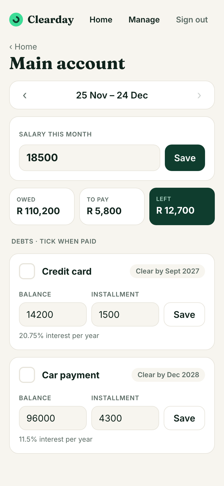
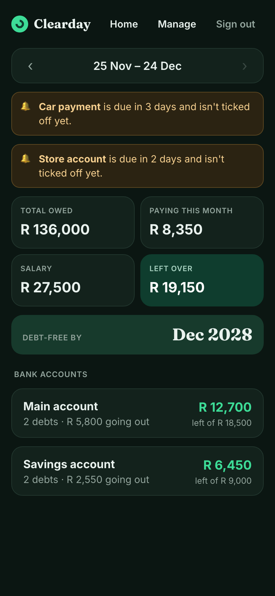

# Clearday

**Know exactly when you'll be debt-free.** A free, private and simple app for tracking monthly debt installments across your bank accounts.

<p>
  
  
  
</p>

## What it does

- **Bank accounts with a salary each.** See how much leaves each account every month and what's left over.
- **Debts with balance and installment.** Tick each one off when it's paid.
- **Automatic carry-over.** Each new month starts with paid debts reduced by their installment. Edit any number if your statement says otherwise.
- **Payday-based months.** A month runs from your payday to the day before the next one.
- **Debt-free date.** A payoff date for every debt (including interest, if you add the rate) and one overall date.
- **Due-soon reminders** for installments that aren't ticked off yet.
- **Private.** Google sign-in only, invite-only, no bank connections. See [SECURITY.md](SECURITY.md).

## Tech

Next.js 16 (App Router, Server Actions) · TypeScript · Prisma 7 + PostgreSQL · Auth.js (Google) · Tailwind CSS 4 · Zod · Vitest · GitHub Actions

The money logic (carry-over, totals, payoff months, pay cycles) lives in small pure functions in [`src/lib`](src/lib) and is tested first. All database access goes through one user-scoped layer, [`src/lib/data.ts`](src/lib/data.ts), with an integration test that proves one user can't see or change another user's data.

## Run it locally

You need Node 24 and Docker.

```bash
cp .env.example .env          # then fill in AUTH_SECRET (npx auth secret) and Google OAuth keys
docker compose up -d          # Postgres for dev (5434) and tests (5435)
npm install
npx prisma migrate dev        # create the tables
npm run db:seed               # optional: fake demo data
npm run dev
```

Add your Google email to `ALLOWED_EMAILS` in `.env` so you can sign in.

## Tests

```bash
npm test             # unit + integration (needs the test database from docker compose)
npm run test:unit    # just the pure logic, no database
```

## Roadmap

- [x] Accounts, debts, salary, monthly carry-over, totals
- [x] Google sign-in with an invite list
- [ ] Payoff calculator: estimate from your real balance history, "what if I pay extra?"
- [ ] Public landing page with a live demo (no sign-up)
- [ ] Suggestions board and "What's new" page
- [ ] Export and delete my data, installable phone app
- [ ] Snowball vs avalanche comparison, milestone celebrations

## License

[MIT](LICENSE)
